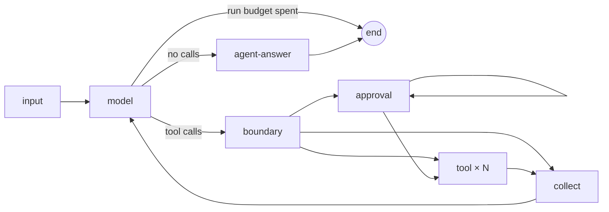

# Agents — the agent's own loop

An `@Agent` runs the framework's **own loop** (#150, `src/graph/agent-loop/`): a compiled LangGraph
subgraph per agent, added to the workflow graph as **one node**, so `describe` and the flow stay
readable. There is no `createAgent` and no LangChain middleware — the loop owns cost accounting,
timeouts, approval and limits. Decision: [ADR-0015](ADR-0015-Own-agent-loop).

## The loop



| Node | Does |
| --- | --- |
| `input` | once per call of the agent: context-mode knowledge, the task, other agents' contributions, memory, decisions on its own calls |
| `model` | one model turn through `ModelGateway.chatModel(…)` with the agent's tools bound; checks the run budget and `modelCalls` before, records usage and checks `toolCalls` after |
| `boundary` | the move joins the conversation; for each call, in order: tool judges → agent judges `beforeToolCall`; a call to a tool the agent does not have is answered `Tool error: there is no tool "…"` |
| `approval` | asks about **one** call that waits (pause seam) and records the decision by `callId` |
| `tool` | one task (`Send`) per allowed call: runs the tool with the run's signal + its `timeoutMs`; stores the result (or `Tool error: …`) under its `callId`; reported costs join the loop's usage |
| `collect` | tool messages in the **call order**, `afterToolCall` (tool, then agent) for calls that ran, decisions recorded; back to `model` |
| `agent-answer` | `beforeAgentAnswer`, then the answer leaves the loop as the agent's contribution |

## The move boundary — in this order

tool judges `beforeToolCall` → agent judges `beforeToolCall` → **approval** → run → `afterToolCall`
judges (tool, then agent); `beforeAgentAnswer` before the answer. A person is never asked about a
move a judge then returns. The judge points are **empty extension points** until #123 fills them.

## Stored calls, crash and resume

- Every finished call's result is stored in the loop's state under its `callId`, checkpointed node
  by node (`durability: "sync"`); each tool call is its own task, so it is stored as soon as it
  finishes.
- **Nothing finished is repeated**: after a pause, a resume or a restart in a new process the loop
  reads stored results — the model is not asked again for a turn it already made.
- **A call interrupted by a crash may run again** (at-least-once). The tool gets the same
  `ctx.callId` — **side-effecting tools must use it as their idempotency key**.
- `callId` is the provider's tool call id; when a provider gives none, the loop assigns one unique
  within the run.

## Tool errors are recoverable

An exception, invalid arguments, an invalid result or an unknown tool reach the model as the call's
result (`Tool error: …`); the loop continues.

## Parallel calls

Calls of one model turn that need no approval run **concurrently**; results are handed to the model
in call order. Calls needing approval are asked first, one per pause, in call order.

## Limits per call of the agent

| Limit | Default | Key when hit |
| --- | --- | --- |
| `modelCalls` | 12 | `agents.<name>.limits.modelCalls` |
| `toolCalls` | 20 | `agents.<name>.limits.toolCalls` |

Counted from the flow handing the agent its work to its answer. Until `@Agent({ limits })` (#152),
`toolCalls` comes from `maxToolCalls` (the agent's, then `defaults.tools.maxToolCalls`) when set.
Hitting one **fails** the run with `LimitExceededError`; the loop's spend so far still reaches the
ledger. `gc describe` shows them: `limits: modelCalls 12 (default) · toolCalls 8`. A spent run
budget ends the loop without a model call (`stopped: run budget exhausted`); the next working node
then fails the run at `limits.perRun.cost`. (`judgeSendBacks` is reserved for #123.)

## Approval

Through an internal interface, `requestApproval(ToolCallApprovalAsk) → ToolCallApprovalDecision`,
backed by the [Pause seam](Pause-seam) until #152 wires it to channels. Approved → the call runs;
rejected → the model reads `Tool error: the call was rejected by <by>[: reason]`.


## Testing

Agents are tested using LLM dynamic mocking. Instead of hitting a real LLM, you can use the `.handle()` syntax to intercept requests and conditionally return tool calls or text answers dynamically.

```ts
import { modelOf, callTool, answer } from "graphcompose/testing";
import { SupportAgent } from "./support.agent";
import { MyTool } from "./my-tool";

// LLM dynamic mocking with .handle()
modelOf(SupportAgent).handle((req) => {
  if (req.input.includes("refund")) {
    return callTool(MyTool, { amount: 100 });
  }
  return answer("I can help with that.");
});

// Asserting the agent's behavior
expect(modelOf(SupportAgent)).toHaveCalledTools([MyTool]);
```

