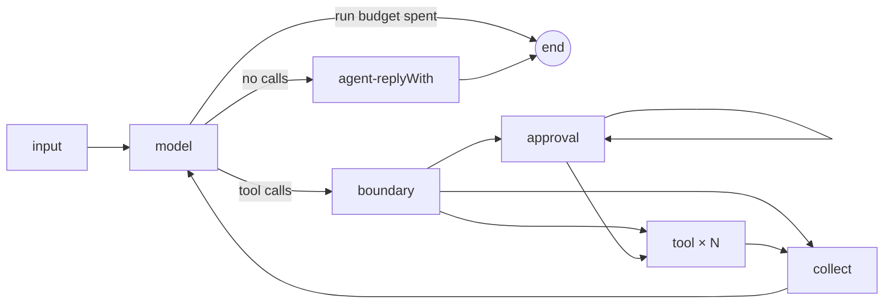

# Agents — the agent's own loop

An `@Agent` runs the framework's **own loop** (#150, `src/graph/agent-loop/`): a compiled LangGraph
subgraph per agent, added to the workflow graph as **one node**, so `describe` and the flow stay
readable. There is no `createAgent` and no LangChain middleware — the loop owns cost accounting,
timeouts, approval and limits. Decision: [ADR-0015](ADR-0015-Own-agent-loop).

## The loop



| Node | Does |
| --- | --- |
| `input` | once per call of the agent: context-mode knowledge, the task, other agents' contributions, memory, decisions on its own calls |
| `model` | one model turn through `ModelGateway.chatModel(…)` with the agent's tools bound; checks the run budget and `modelCalls` before, records usage and checks `toolCalls` after |
| `boundary` | the move joins the conversation; for each call, in order: tool judges → agent judges `beforeToolCall`; a call to a tool the agent does not have is answered `Tool error: there is no tool "…"` |
| `approval` | asks about **one** call that waits (pause seam) and records the decision by `callId` |
| `tool` | one task (`Send`) per allowed call: runs the tool with the run's signal + its `timeoutMs`; stores the result (or `Tool error: …`) under its `callId`; reported costs join the loop's usage |
| `collect` | tool messages in the **call order**, `afterToolCall` (tool, then agent) for calls that ran, decisions recorded; back to `model` |
| `agent-replyWith` | `beforeAgentAnswer`, then the answer leaves the loop as the agent's contribution |

## The move boundary — in this order

the tool's guardrails `beforeToolCall` → the agent's guardrails `beforeToolCall` → **approval** → run →
`afterToolCall` guardrails (tool, then agent); `beforeAgentAnswer` before the answer leaves the loop,
then the agent's judges ([Judges and quality gates](Judges-And-Quality-Gates)). A person is never asked
about a move a guardrail then rejects ([Guards](Guards)).

## Stored calls, crash and resume

- Every finished call's result is stored in the loop's state under its `callId`, checkpointed node
  by node (`durability: "sync"`); each tool call is its own task, so it is stored as soon as it
  finishes.
- **Nothing finished is repeated**: after a pause, a resume or a restart in a new process the loop
  reads stored results — the model is not asked again for a turn it already made.
- **A call interrupted by a crash may run again** (at-least-once). The tool gets the same
  `ctx.callId` — **side-effecting tools must use it as their idempotency key**.
- `callId` is the provider's tool call id; when a provider gives none, the loop assigns one unique
  within the run.

## Tool errors are recoverable

An exception, invalid arguments, an invalid result or an unknown tool reach the model as the call's
result (`Tool error: …`); the loop continues.

## Parallel calls

Calls of one model turn that need no approval run **concurrently**; results are handed to the model
in call order. Calls needing approval are asked first, one per pause, in call order.

## Limits per call of the agent

| Limit | Default | Key when hit |
| --- | --- | --- |
| `modelCalls` | 12 | `agents.<name>.limits.modelCalls` |
| `toolCalls` | 20 | `agents.<name>.limits.toolCalls` |

Counted from the flow handing the agent its work to its answer. Until `@Agent({ limits })` (#152),
`toolCalls` comes from `maxToolCalls` (the agent's, then `defaults.tools.maxToolCalls`) when set.
Hitting one **fails** the run with `LimitExceededError`; the loop's spend so far still reaches the
ledger. `gc describe` shows them: `limits: modelCalls 12 (default) · toolCalls 8`. A spent run
budget ends the loop without a model call (`stopped: run budget exhausted`); the next working node
then fails the run at `limits.perRun.cost`. 

## Approval

A tool declared with a `channel` (`@Tool({ channel: TerminalUserChannel })`, the channel listed in
`@Workflow({ channelClasses })`) waits for a decision before it runs: the run pauses
(`status: "paused"`, `ExecutionOutput.pause`) and `app.resume(thread, decision)` continues it with a
`ToolCallApprovalDecision` ([Pause seam](Pause-seam)). Approved → the call runs; rejected → the
model reads `Tool error: the call was rejected by <by>[: reason]`.

## Testing

An agent answers by script in a workflow test: `replyWith(text)`, `callTool(Tool, args)` (args typed by
the tool's input DTO), or a function of the request with `.thenAnswer(...)` ([Testing](Testing)):

<!-- snippet-context
import { Agent, Tool, Workflow, WorkflowFinish, WorkflowSettings, WorkflowStart, chain, type ToolHandler, type WorkflowDefinition } from "graphcompose";
import { Integer, Text, WorkflowFinishText, WorkflowStartText } from "graphcompose/dto";
class RefundRequest { @Integer({ prompt: "the amount, USD" }) amount!: number; }
class RefundDone { @Text() status!: string; }
@Tool({ name: "refund", description: "Refunds an amount", input: RefundRequest, output: RefundDone })
class RefundTool implements ToolHandler<RefundRequest, RefundDone> { run(): Promise<RefundDone> { return Promise.resolve({ status: "refunded" }); } }
@WorkflowStart({ name: "chat", description: "A message", input: WorkflowStartText })
class ChatStart { declare readonly input: WorkflowStartText; }
@WorkflowFinish({ name: "chat", description: "The answer", output: WorkflowFinishText })
class ChatFinish {}
@Agent({ name: "support", description: "Helps", prompt: "Help the customer.", model: "moonshotai/kimi-k2.6", tools: [RefundTool] })
class SupportAgent {}
@Workflow({ name: "support", version: "1.0.0", flow: [chain(ChatStart, SupportAgent, ChatFinish)], defaults: { models: { temperature: 0 }, router: { kind: "jev", model: "typesafe/jev-1.13" }, history: { limit: 5 } } })
class SupportWorkflow implements WorkflowDefinition { settings() { return WorkflowSettings.builder().build(); } }
-->

```ts
import { expect } from "vitest";
import { callTool, replyWith, testWith } from "graphcompose/testing";

const test = testWith(SupportWorkflow);

test("a refund request calls the refund tool, then answers", async ({ app, mockLlm }) => {
  mockLlm(SupportAgent).thenAnswer((request) =>
    request.kind === "chat" && request.messages.some((line) => line.role === "tool")
      ? replyWith("Refunded.")
      : callTool(RefundTool, { amount: 100 }),
  );

  const result = await app.execute(ChatStart, { text: "refund me 100" });

  expect(mockLlm(SupportAgent)).toHaveCalledTools([RefundTool]);
  expect(result).toFinishWith(ChatFinish, { text: "Refunded." });
});
```
