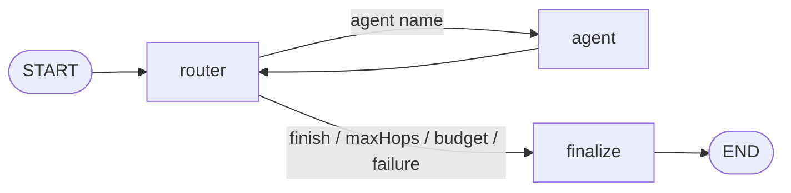

# Architecture

- **router** — graph adapter around a `Router` (see [Routers](Routers)): renders state into plain
  text, applies guards (`maxHops`, run budget) before paying for a call, maps the outcome to state.
- **agent** — runs the agent the router picked, with its own model, prompt, thinking and cache
  settings; appends a contribution and a usage record.
- **finalize** — answer = latest contribution.
- **runAgent** (entry point) — checks the daily cap before the graph starts (see [FinOps](FinOps)).

## Modules and dependency rules

| Module        | Responsibility                                       | May depend on                                    |
| ------------- | ---------------------------------------------------- | ------------------------------------------------ |
| `src/config`  | config schema, types, defaults resolution            | —                                                |
| `src/finops`  | usage records, cost, reports, daily cap              | config, llm (types)                              |
| `src/llm`     | OpenRouter chat factory, Jev client, cache, registry | config                                           |
| `src/routers` | routing strategies (Jev, LLM)                        | config, finops, llm — **only**                   |
| `src/tools`   | typed tools, registry, LangChain adapter             | config, finops, llm — **only**                   |
| `src/prompts` | agent prompts, graph-level prompt text               | config                                           |
| `src/graph`   | state, nodes, assembly                               | everything above; routers via `routers/index.ts` |

Router and tool isolation rules are enforced by ESLint (`no-restricted-imports`); the rest of `src` imports them only via their `index.ts`.
