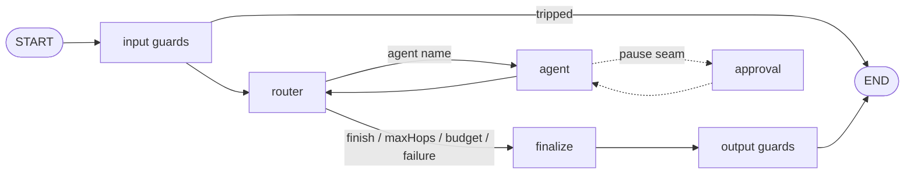

# Architecture

The framework lives in `packages/graphcompose/` (paths below are relative to it); the example in
`examples/job-scout/` ([Example](Example)). ADR: [0011](ADR-0011-GraphCompose-framework-package-and-examples-apart).

- **router** — graph adapter around a `Router` (see [Routers](Routers)): renders state into plain
  text, applies guards (`maxHops`, run budget) before paying for a call, maps the outcome to state.
- **agent** — runs the agent the router picked as a model ↔ tool loop (`createAgent`) with its own
  model, prompt, thinking, cache settings and tools; middleware records every call and stops at the
  run budget; crossing `maxToolCalls` fails the run; with `reasoning`, Jev scores each attempt and the agent retries with more thinking until the threshold or the attempt limit. See [Tools](Tools), [Configuration](Configuration).
- **finalize** — answer = the last agent's answer.
- **input / output guards** — Jev yes/no checks with thresholds; a trip replaces the answer with a refusal. See [Guards](Guards).
- **runAgent** (entry point) — checks the daily cap before the graph starts (see [FinOps](FinOps)).

## Modules and dependency rules

| Module               | Responsibility                                             | May depend on                                    |
| -------------------- | ---------------------------------------------------------- | ------------------------------------------------ |
| `src/config`         | config schema, types, defaults resolution                  | —                                                |
| `src/finops`         | usage records, cost report, daily ledger                   | config, llm (types)                              |
| `src/llm`            | OpenRouter chat factory, Jev client, cache, registry       | config                                           |
| `src/routers`        | routing strategies (Jev, LLM)                              | config, finops, llm — **only**                   |
| `src/tools`          | typed tools, registry, MCP facades, LangChain adapter      | config, finops, llm — **only**                   |
| `src/terns`          | run records, threads, scores (SQLite)                      | nothing in `src` — **isolated**                  |
| `src/guards`         | input / output guards                                      | config, routers, finops                          |
| `src/pause`          | pause seam types and policy                                | tools (types)                                    |
| `src/prompts`        | agent, routing, guard, reasoning texts                     | config, guards (types)                           |
| `src/tracing`        | optional run tracing (Langfuse)                            | —                                                |
| `src/graph`          | state, nodes, assembly, middleware                         | everything above; routers via `routers/index.ts` |
| `src/run`            | runAgent / resumeAgent: threads, budget, Terns, financials | graph, finops, terns, prompts, routers, tracing  |
| `src/eval`           | Jev judge, eval, replay                                    | run, routers, terns, finops                      |
| `src/workflow.ts`    | workflow (config + prompts + tools + MCP + pause)          | config, prompts, tools, routers (types)          |
| `src/app.ts`         | production wiring of a workflow                            | all of the above                                 |
| `src/cli`            | terminal helpers for `cli.ts` / `chat.ts`                  | run (public API), finops                         |
| `examples/job-scout` | the example — a separate package using only `graphcompose` | `graphcompose` only                              |

Router, tool and Tern isolation rules are enforced by ESLint (`no-restricted-imports`); the rest of
`src` imports them only via their `index.ts`.
