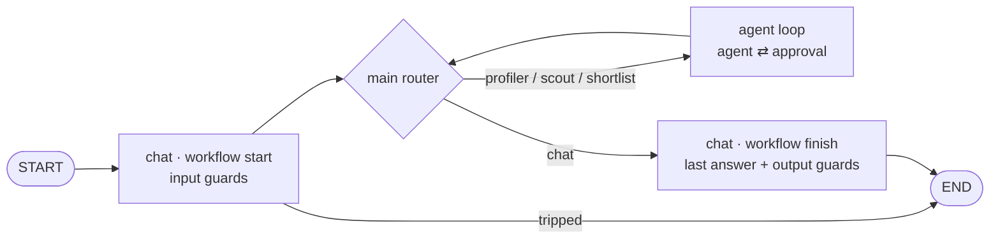

# Architecture

The framework lives in `packages/agboss/` (paths below are relative to it); the example in
`examples/job-scout/` ([Example](Example)). ADR: [0011](ADR-0011-graphInject-framework-package-and-examples-apart).

The workflow file **is** the graph ([Workflow](Workflow), [ADR-0014](ADR-0014-Graph-as-transitions)):
transitions between `@WorkflowStart`, `@Router`, `@Agent`, `@WorkflowAction` and `@WorkflowFinish` classes, checked at assembly and
run as a LangGraph `StateGraph`. job-scout is a star:

- **workflow start** — where a run starts (`@WorkflowStart`); runs the input guards — a trip ends the run before any
  working node spends money. See [Guards](Guards).
- **router** — a `@Router` node: asks its own model (Jev or a chat model, see [Routers](Routers)) to
  pick one of its routes; a failed call or an unknown option **fails** the run; after a human decision
  it sends the turn to its workflow finish without a call (#100).
- **agent** — the agent's own loop as a compiled subgraph (#150): model turns, the move boundary
  (guardrails, approval — one call per pause; judges on the reply), tool calls as parallel tasks stored by `callId`;
  usage recorded per call, the run budget checked before each call, `modelCalls` / `toolCalls`
  limits fail the run. See [Agents](Agents), [Tools](Tools), [Pause seam](Pause-seam).
- **workflow finish** — where a run finishes (`@WorkflowFinish`): answer = the last agent's answer, then the output
  guards (a trip replaces it with a refusal).
- **limits** — steps, router visits, spend per run and per day, checked before each working node;
  hitting one **fails** the run (`LimitExceededError`). See [Workflow](Workflow), [FinOps](FinOps).
- **app** (`createApp` → `execute` / `resume` / `cancel` / `close`, [App](App)) over the run layer
  (`src/run`: `runAgent` / `resumeAgent`) — check the
  daily cap before the graph starts, record spend as it happens, write a Tern for every outcome
  (answered, guarded, paused, failed).

## Modules and dependency rules

| Module               | Responsibility                                             | May depend on                                    |
| -------------------- | ---------------------------------------------------------- | ------------------------------------------------ |
| `src/config`         | config schema, types, defaults resolution                  | —                                                |
| `src/finops`         | usage records, cost report, daily ledger                   | config, llm (types)                              |
| `src/llm`            | OpenRouter chat factory, Jev client, cache, registry       | config                                           |
| `src/routers`        | routing strategies (Jev, LLM)                              | config, finops, llm — **only**                   |
| `src/tools`          | typed tools, registry, MCP facades, LangChain adapter      | config, finops, llm — **only**                   |
| `src/terns`          | run records, threads, scores (SQLite)                      | nothing in `src` — **isolated**                  |
| `src/guards`         | input / output guards                                      | config, routers, finops                          |
| `src/pause`          | pause seam types and policy                                | tools (types)                                    |
| `src/prompts`        | agent, agent-loop, routing, guard texts                    | config, guards (types)                           |
| `src/tracing`        | optional run tracing (Langfuse)                            | —                                                |
| `src/graph`          | flow DSL, rules, decorators, engine, nodes, limits         | everything above; routers via `routers/index.ts` |
| `src/run`            | runAgent / resumeAgent: threads, Terns                     | graph, finops, terns, prompts, routers, tracing  |
| `src/eval`           | Jev judge, eval, replay                                    | run, routers, terns, finops                      |
| `src/workflow.ts`    | workflow (flow + limits + config + prompts + tools + MCP)  | config, graph, prompts, tools, routers (types)   |
| `src/app`            | `createApp`, production wiring (`createAppDeps`)           | all of the above                                 |
| `src/testing`        | `agboss/testing`: testWith, scripted models, matchers | app, graph, llm (gateway), tools — tests only   |
| `src/internal.ts`    | `agboss/internal`: what the CLI is built on (not public) | app, loader, describe, eval                  |
| `packages/agboss-cli` | the `agboss` command — a separate package            | `agboss` (+ `/internal`)                   |
| `examples/job-scout` | the example — a separate package using only `agboss` | `agboss` (+ `/dto`, `/units`, `/models`, `/mcp`, `/rag`) |

Router, tool and Tern isolation rules are enforced by ESLint (`no-restricted-imports`); the rest of
`src` imports them only via their `index.ts`.
