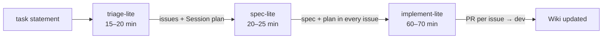

# Delivery Pipeline

How work gets from a requirement to merged code with Claude Code. A compact version of a
day/night conveyor: humans spend their time on specs, agents on code.

| Phase     | Skill            | Output — where                                                                                                                                                                                      |
| --------- | ---------------- | --------------------------------------------------------------------------------------------------------------------------------------------------------------------------------------------------- |
| Triage    | `triage-lite`    | clarified requirements; 4–7 vertical-slice issues (`feature` / `bugfix` / `chore`, `mvp` / `stretch`); a `Session plan` issue — **GitHub Issues**                                                   |
| Spec      | `spec-lite`      | in each issue: spec, implementation plan, acceptance criteria, test cases (main / edge / regression), wiki pages to update, what a human must check — **issue body** (plan in comments if too long) |
| Implement | `implement-lite` | per issue: branch `<type>-<N>` from `dev`, tests first, `make check`, self-review against `QUALITY.md`, PR `Closes #N`, squash-merge after CI, then Wiki update and a report comment                |

Skills live in `.claude/skills/`. Issue and PR bodies go to `gh` via stdin — never through files.

## Labels

`type:feature` · `type:bugfix` · `type:chore` · `prio:mvp` · `prio:stretch` ·
`status:triaged → spec-ready → in-progress` (or `status:blocked` with a comment).

## Definition of Done

Acceptance criteria met · every spec test case exists · `make check` green · self-review done ·
Wiki updated (ADR if a significant decision was made) · PR merged to `dev`, issue closed with a
report.

## Promotion

`dev → staging → production` by PR, as a release step — never by the agent during a session.
