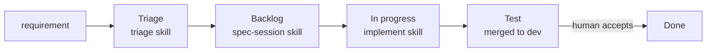

# Delivery Pipeline — the conveyor

Humans decide _what_ and _how_ through short quizzes; agents write the code, in parallel.
Every ticket's stage is the `Status` field on the repo's GitHub Project board.

| Stage           | Set by                    | What the ticket contains                                                                                                                                                                                                                                  |
| --------------- | ------------------------- | --------------------------------------------------------------------------------------------------------------------------------------------------------------------------------------------------------------------------------------------------------- |
| **Triage**      | `triage`                  | why · what it does · what it does NOT do · constraints · acceptance criteria AC1… (business terms) · triage log                                                                                                                                           |
| **Backlog**     | `spec-session`            | + spec · implementation plan (files, parallel?, dependencies) · every business **AC** proven: **automated** (→ tests) and **manual** (where / do / expect / not OK if) checks, with a coverage table AC → checks · test cases · wiki to update · spec log |
| **In progress** | `implement` (start)       | branch `<type>-<N>` from `dev`                                                                                                                                                                                                                            |
| **Test**        | `implement` (after merge) | PR merged to `dev` (`Refs #N`), handoff comment with the manual acceptance checklist                                                                                                                                                                      |
| **Done**        | **human only**            | accepted; the human closes the issue                                                                                                                                                                                                                      |

## Quizzes — built for parallel sessions

Triage and spec run in 4–6 terminals at once, so every question is answerable cold
(`.claude/skills/QUIZ.md`):

- asked with the `AskUserQuestion` tool, up to 4 per round;
- the question restates the **ticket**, an **example situation** and the **decision**;
- each option states its **price**: 👍 benefit · 👎 cost (time, money, complexity, risk);
- the recommended option comes first; decisions are written to the issue log after each round.

## Parallel implementation

`implement` builds waves from `Depends on` and `Files touched`: issues in a wave share no files and
have their dependencies merged, so they run in parallel — one git worktree + sub-agent per issue,
or one Claude Code on the web session per issue. A ticket a fresh worker cannot implement from the
issue alone is a spec defect and gets `blocked`.

## Hierarchy and blocking

- Large work: parent issue (`type:epic`) with sub-issues — `scripts/ticket.sh sub <parent> <child>`.
- Cannot proceed: label `blocked` + comment (known / blocking / needed); the stage stays.

## Tools

| Command                                  | Purpose                            |
| ---------------------------------------- | ---------------------------------- |
| `scripts/ticket.sh setup`                | create and configure the board     |
| `scripts/ticket.sh status <N> "<Stage>"` | move a ticket                      |
| `scripts/ticket.sh list "<Stage>"`       | tickets in a column                |
| `scripts/ticket.sh sub <parent> <child>` | sub-issue                          |
| `scripts/wiki.sh pull / publish`         | Wiki working copy `../<repo>.wiki` |

## Promotion

`dev → staging → production` by PR, as a release step — never by an agent.
