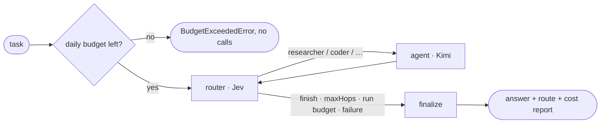

# GraphCompose

[](https://github.com/PavelRavvich/graphcompose/actions/workflows/ci.yml)
[](https://github.com/PavelRavvich/graphcompose)

A GitHub **template** for building LLM agent systems in TypeScript, with two things inside:

1. **Agent Core** — a config-driven multi-agent runtime on LangGraph: routers pick specialist
   agents, every model call is typed, tested and paid for within a budget.
2. **Delivery conveyor** — how the code is built with Claude Code: tickets move
   **Triage → Backlog → In progress → Test → Done** on the repo's board; triage and spec are
   quiz-driven, implementation runs in parallel. See [Delivery Pipeline](Delivery-Pipeline).

Create a new project from it (`gh repo create <name> --template PavelRavvich/graphcompose
--include-all-branches`), describe the agents in one config file, and start shipping tickets.
The template ships the core and a CLI only; entry points like webhooks, chat or schedules are
added in the project as thin adapters over `runAgent` ([ADR-0002](ADR-0002-Core-and-CLI-only)).

---

## Quick start

```bash
npx gc create my-agents   # questionnaire → a working project (see [CLI](CLI))
cd my-agents && cp .env.example .env && npm run chat
```

## Agent Core



A task enters the graph; the **router** decides which **agent** should work next, the agent adds
its contribution, and the loop repeats until the router says _finish_ or a guard stops it. The
result is the answer, the route taken and an itemised cost report.

### What makes it a core, not an example

| Property                        | How                                                                                                                                                                                                                                                                               |
| ------------------------------- | --------------------------------------------------------------------------------------------------------------------------------------------------------------------------------------------------------------------------------------------------------------------------------- |
| **Components**                  | Agents, tools and MCP servers are annotated classes in folders; a `@Workflow` module wires them by class reference ([Components](Components))                                                                                                                                     |
| **Routing by a decision model** | Routers default to **Jev** (TypeSafe) via the OpenRouter Decisions API: calibrated probabilities over the options and exact cost per call, instead of parsing free text. Any router can switch to an LLM in config. → [Routers](Routers), [ADR-0001](ADR-0001-Jev-default-router) |
| **Routers are isolated**        | A router sees only `{ input, options }` and returns `decided \| failed`. It cannot import the graph or agents (ESLint-enforced) and has its own test suite (`npm run test:routers`).                                                                                              |
| **One provider gateway**        | All models go through OpenRouter with one key. Agents default to a cheap model (Kimi K2.6); each agent can override model, temperature, `maxTokens` (`MODEL_MAX` = the model's own limit), `thinking` and `cache`.                                                                |
| **FinOps built in**             | Every call is recorded (tokens, cache hits, USD, source of the price). Each run has `runBudgetCap`; each workflow has `dailyBudgetCap`, reset at 00:00 UTC, kept in a ledger outside the repo. → [FinOps](FinOps)                                                                 |
| **Typed end to end**            | Strict TypeScript, named domain types, generics for reusable parts, discriminated unions for outcomes, zod at every boundary. No `any`, no casts except at validated boundaries.                                                                                                  |
| **Tested without spending**     | Unit tests run on fake models and cost $0 (100% coverage in the gate); real calls only in `make smoke`.                                                                                                                                                                           |

### Run it

```bash
make setup
cp .env.example .env            # OPENROUTER_API_KEY=...
npm start -- "Explain what a monad is and show a TypeScript example"
# example output (illustrative numbers):
# stdout: answer
# stderr: route: researcher → coder | stop: jev confidence 0.91
#         budget for this run: $0.0500
#         cost: $0.003120 in 5 calls {"router:main":0.00006,"researcher":0.0011,"coder":0.00196}
npm run studio                  # the graph in LangGraph Studio
```

### Code map

| Path                  | What lives there                                                                        |
| --------------------- | --------------------------------------------------------------------------------------- |
| `src/config/`         | config schema, profiles, defaults resolution                                            |
| `src/components/`     | `@Tool` `@Agent` `@McpServer` `@McpTool` `@Injectable` `@Workflow`, container, assembly |
| `examples/job-scout/` | the example workflow — a separate package ([Example](Example))                          |
| `src/graph/`          | state, router / agent / finalize nodes, graph assembly                                  |
| `src/routers/`        | isolated routing strategies (Jev, LLM); public API = `index.ts`                         |
| `src/llm/`            | OpenRouter chat factory (thinking), Jev client, prompt caching, model registry          |
| `src/finops/`         | usage records, cost, daily ledger, recording while the graph streams                    |
| `src/prompts/`        | agent system prompts, graph-level prompt text                                           |
| `src/index.ts`        | `runAgent()` — the public entry point                                                   |
| `tests/`              | unit tests; `tests/routers/` — routers alone; `tests/smoke/` — real models              |

Module dependency rules: [Architecture](Architecture).

---

## Working in this repo

| Kind of knowledge                                      | Place                                                  |
| ------------------------------------------------------ | ------------------------------------------------------ |
| Tickets, discussion, **specs, implementation plans**   | GitHub Issues                                          |
| How the system works **now**                           | this Wiki                                              |
| Why a significant decision was made                    | Wiki pages `ADR-NNNN-…` → [ADR](ADR)                   |
| Rules for code, types, agents, FinOps, tests · process | `QUALITY.md` · `WORKFLOW.md` · `CLAUDE.md` in the repo |
| The truth                                              | the code                                               |

No specs, plans or docs are stored as files in the repository.

**Board**: [Project](https://github.com/users/PavelRavvich/projects/5) — stage of every ticket; Done is set by a human.

**Branches**: `production ← staging ← dev ← <type>-<issue>` (e.g. `feature-12`). Work starts and
ends in `dev` through a PR; the gate is `make check` (types, lint, format, tests, coverage ≥ 80%).

## Status

| Area                       | State                                                                          |
| -------------------------- | ------------------------------------------------------------------------------ |
| Agent Core, tests, gate    | done, green                                                                    |
| Real calls (Jev, Kimi)     | wired, smoke test not run yet                                                  |
| Jev Decisions API          | alpha — router failures end a run safely; LLM router is one config switch away |
| Triggers beyond chat / CLI | next: webhook / schedule / GitHub events                                       |

**Try it:** [Example](Example) — two configs to play with in the CLI and LangGraph Studio.
