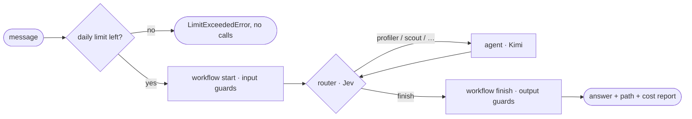

# GraphCompose

[](https://github.com/PavelRavvich/graphcompose/actions/workflows/ci.yml)
[](https://github.com/PavelRavvich/graphcompose)

Typed agent workflows on LangGraph, in TypeScript. Agents, tools, MCP servers and knowledge bases are
**Angular-style components** — annotated classes, wired by a `@Workflow` module, dependencies through
the constructor, every link checked by the compiler. Routing and judging by decision models (Jev, …),
FinOps on every call, Terns and evaluation, profiles and comparisons, tracing.

The repository holds two things:

1. **The framework** — the npm package `graphcompose` (`packages/graphcompose`), its CLI `gc`
   (`packages/graphcompose-cli`) and the example `examples/job-scout`.
2. **The delivery conveyor** — how the code is built with Claude Code: tickets move
   **Triage → Backlog → In progress → Test → Done** on the repo's board. See
   [Delivery Pipeline](Delivery-Pipeline).

Every ` ```ts ` block of this wiki compiles against the current package: CI clones the wiki and runs
`node scripts/check-docs.mjs --wiki wiki` (the same check as the repo's docs).

---

## Quick start

```bash
npx -p graphcompose-cli gc create my-agents   # questionnaire → a working project (see [CLI](CLI))
cd my-agents && cp .env.example .env && npm run chat
```

Or add it to a project: `npm i graphcompose` and `npm i -D graphcompose-cli`, then write the
components ([Components](Components)).

## Agent Core



The workflow file is the graph: transitions between a **workflow start**, **routers**, **agents**,
**actions** and **workflow finishes** ([Workflow](Workflow)). A message enters at the workflow start;
a **router** decides which **agent** works next, the agent adds its contribution, and the loop repeats
until the router sends the turn to a **workflow finish** or a guard stops it. Limits (steps, router
visits, spend per run and per day) fail the run instead of letting it loop. The result
(`ExecutionOutput`) is the finish's output, the path taken and an itemised cost report.

### What makes it a framework, not an example

| Property                        | How                                                                                                                                                                                                                                     |
| ------------------------------- | --------------------------------------------------------------------------------------------------------------------------------------------------------------------------------------------------------------------------------------- |
| **Components**                  | Agents, tools and MCP servers are annotated classes in folders; a `@Workflow` module wires them by class reference ([Components](Components))                                                                                           |
| **Routing by a decision model** | Routers default to **Jev** (TypeSafe) via the OpenRouter Decisions API: calibrated probabilities over the options and exact cost per call, instead of parsing free text. Any `@Router` can name a chat model instead → [Routers](Routers) |
| **Routers are isolated**        | A router engine sees only `{ input, options }` and returns `decided \| failed`; inside the framework it cannot import the graph or agents (ESLint-enforced) and has its own tests                                                       |
| **Model providers**             | Every model comes from a `@ModelProvider` (OpenRouter and the Decisions API built in): timeouts, retries, circuit breakers, costs, reasoning and caching per provider → [Model providers](Model-providers)                              |
| **FinOps built in**             | Every call is recorded (tokens, cache hits, USD, source of the price). Each workflow's `settings()` sets `limits.perRun.cost` and `limits.perDay.cost` (reset at 00:00 UTC, kept in a ledger outside the repo) → [FinOps](FinOps)       |
| **Typed end to end**            | Strict TypeScript, DTO classes at every boundary, deps checked against constructors, scripted test turns typed by the tool's input                                                                                                    |
| **Tested without spending**     | `graphcompose/testing` runs a whole workflow with scripted models and the network blocked ([Testing](Testing)); real calls only in `make smoke`                                                                                         |

### Run the example

```bash
npm install && npm run build          # at the repo root
cd examples/job-scout && npm run chat # "my resume src/data/sample-resume.md"
npm run describe                      # agents, tools, dependencies — no API key
```

More: [Example](Example). `npm run studio` (repo root) opens the graph in LangGraph Studio.

### Public entries

`graphcompose` (decorators, DI, flow DSL, settings, environments, observers, judges and decisions,
`createApp`, errors, types), `graphcompose/dto`, `/units`, `/models`, `/testing` (+
`/testing/setup`), and the integrations `/mcp`, `/rag`, `/a2a`, `/memory`. The older entries are
deprecated re-exports; `gc migrate imports` rewrites them.

### Code map (`packages/graphcompose/src/`)

| Path          | What lives there                                                                             |
| ------------- | -------------------------------------------------------------------------------------------- |
| `app/`        | `createApp` → `app.execute` / `resume` / `cancel` / `close`; production wiring               |
| `components/` | `@Tool` `@Agent` `@Injectable` `@Workflow` …, the DI container, assembly                     |
| `graph/`      | the flow DSL, assembly rules, LangGraph build, the agent loop, limits, settings             |
| `dto/`        | field decorators, DTO validation, the standard DTOs                                          |
| `routers/`    | isolated routing engines (Jev, LLM); public inside the framework only via `index.ts`         |
| `models/`     | model providers                                                                              |
| `finops/`     | usage records, cost, daily ledger                                                            |
| `testing/`    | `testWith`, scripted gateway, matchers, VCR                                                  |
| `index.ts`    | the root entry `graphcompose`                                                                |

Module dependency rules: [Architecture](Architecture).

---

## Working in this repo

| Kind of knowledge                                      | Place                                                  |
| ------------------------------------------------------ | ------------------------------------------------------ |
| Tickets, discussion, **specs, implementation plans**   | GitHub Issues                                          |
| How the system works **now**                           | this Wiki                                              |
| Why a significant decision was made                    | Wiki pages `ADR-NNNN-…` → [ADR](ADR)                   |
| Rules for code, types, agents, FinOps, tests · process | `QUALITY.md` · `WORKFLOW.md` · `CLAUDE.md` in the repo |
| The truth                                              | the code                                               |

No specs, plans or docs are stored as files in the repository.

**Board**: [Project](https://github.com/users/PavelRavvich/projects/5) — stage of every ticket; Done is set by a human.

**Branches**: `production ← staging ← dev ← <type>-<issue>` (e.g. `feature-12`). Work starts and
ends in `dev` through a PR; the gate is `make check` (build, API reports, compiled docs, format,
lint, types, tests with coverage).

**Try it:** [Example](Example).
