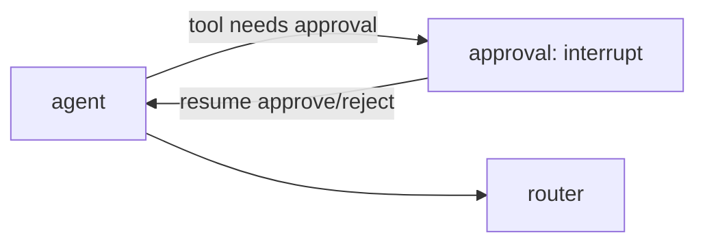

# Pause seam

The core never pauses by default: a run ends at a terminal node and the next question is a new run
in the same thread. When a project needs a human in the loop — typically to approve a tool with
`effect: "write"` — it plugs in the **pause seam**. The core defines where and how, so pause does not
contradict budgets, spend recording or Terns.

## Plug it in

```ts
import { MemorySaver } from "@langchain/langgraph"; // tests; use a durable saver in projects
import { writeToolsNeedApproval } from "./src/pause/index.js";

const deps = {
  ...(await createAppDeps()),
  pause: { checkpointer, needsApproval: writeToolsNeedApproval },
};

const first = await runAgent({ task: "Email the report to my boss" }, deps);
if (first.status === "paused") {
  // first.pending = { agent, tool: "send_email", args: { to: "…" } } → ask a person or a system
  const done = await resumeAgent(
    first,
    { approved: true, by: "pavel" /* or approved: false, reason: "not now" */ },
    deps,
  );
}
```

The decision is a `ToolCallApprovalDecision` (`graphcompose/dto`): `approved`, `by` — who or what
decided, `reason?` — why, if a reason was given. It is validated on resume (`DtoValidationError`
otherwise). `gc chat` asks in the terminal and fills `by` with the OS user name
(`os.userInfo().username`); a decline carries `reason: "declined in the terminal"`.

`needsApproval(tool)` decides which tools wait (default: write tools). The checkpointer (SQLite,
Postgres, …) and the channel that asks the human belong to the project (ADR-0002).

## How it works



1. Inside the agent loop the call is **not executed**: it becomes `pending`, the model gets no further
   call, the loop's agent step ends normally.
2. The loop's `approval` step calls LangGraph `interrupt(pending)`: the run is **paused**, not
   finished. The agent loop (agent ⇄ approval) is a compiled subgraph inside the agent's flow node
   (#116), so the model calls before the pause are checkpointed and never repeated on resume; the
   spend so far is read from the loop's checkpoint and written to the ledger at the pause.
3. `resumeAgent(paused, decision)` continues the same run: approved → the tool runs **once**;
   rejected → `Tool error: the call was rejected by <by>: <reason>` (`by` from the decision). The agent runs again; if the model calls the
   same tool with the same arguments, it gets the stored decision instead of a new request.

## Rules that keep the core consistent

| #   | Rule                                                                                      |
| --- | ----------------------------------------------------------------------------------------- |
| 1   | Spend before the pause is already in the ledger; on resume nothing is recorded twice      |
| 2   | The run budget left at the pause is checkpointed and carried over                         |
| 3   | The Tern is written with status `paused` and completed (same id) on resume                |
| 4   | Guards, limits, `maxToolCalls`, history apply to the paused-and-resumed run as one run    |
| 5   | A rejection reaches the model as a tool error                                             |

After the decision and the agent's answer the router sends the turn to its workflow finish without a
model call (#100). Resuming a run that is not paused (or twice) → `NotPausedError`. A failure after resume completes
the same Tern as `failed`. Decision recorded in [ADR-0004](ADR-0004-Pause-seam).

## After the decision

The graph goes `approval → agent`: the agent sees its decided call (approved and done, with the tool's
result, or rejected) and answers. **Then the turn ends** — the router is not asked again
(`stop: the agent answered after the approval decision`); a follow-up goes to the next turn (#100).
